# The Energy Transition, Unrolled: A Two-Iteration Visual Analytics Workflow

**DAS732 Data Visualization, Programming Assignment 3 (A3)** · IIIT Bangalore · Term 1 2026-27

Dataset: *World Energy Consumption* (Our World in Data) · Tools: Python 3.13 (pandas, scikit-learn, statsmodels, matplotlib, plotly), one reproducible notebook (`notebooks/A3_workflow.ipynb`)

**Analysis types (PDF task 1), labelled throughout:** **[Statistics]** trend, correlation, regression and group tests; **[Unsupervised]** K-means, PCA and Gaussian mixtures; **[Supervised]** Random Forest regression and time-series forecasting.

## 1. Introduction and research question

> **How are the world's countries moving through the energy transition, and does getting richer still mean using more energy and running a dirtier electricity grid?**

The question follows on from our A1 visual exploration (Appendix A). A1 found that the global energy mix barely moved between 1990 and 2022, that national income predicts how *much* energy a country uses far better than how *clean* it is, and that the electricity grid is the one part of the system visibly in motion (A1, Executive Summary and Cross-Cutting Synthesis). A1 was descriptive: it drew charts of complete-case panels. A3 adds statistical tests, unsupervised and supervised models, and a feedback loop in which what the first iteration learns reshapes the data for a second iteration, following the visual analytics process of Keim et al. [1].

## 2. Dataset

The only input is OWID's *World Energy Consumption* file [2]: 22,012 rows, 306 entities, years 1900-2022. It is a long-format country-year panel of primary energy by source, electricity generation and its mix, grid carbon intensity, GDP and population. Its main limits shape every later choice: GDP ends in 2018, the electricity mix is dense only from 2000, 2022 covers about half of the countries, and fossil production is listed only for main producers from 2017 on.

**Supplementary data: none.** No external dataset was joined. Region and income classifications (e.g. World Bank groups) would have been the obvious additions, but they would introduce a second source with its own definitions, years and country codes. Instead, income tiers are derived from the dataset itself as quartiles of each country's mean GDP per person over 2000-02 (Table 1). They are data-derived groups, not official classifications.

**Table 1.** Income tiers (quartiles of mean GDP per person, 2000-02).

| Tier | GDP per person from ($) | to ($) | Countries |
|---|---|---|---|
| Low | 446 | 2,239 | 41 |
| Lower-middle | 2,239 | 6,818 | 40 |
| Upper-middle | 6,818 | 16,804 | 40 |
| High | 16,804 | 56,490 | 41 |

## 3. The visual analytics workflow

Keim et al. [1] describe visual analytics as a loop between data, visualization, models and knowledge. We run that diamond twice and draw it *unrolled* (Figure 1): iteration 1 on the raw 2018 snapshot, iteration 2 on the transformed data. One edge, labelled *Feedback loop*, joins them: it carries four inferences from iteration 1 to four transformations of the data. Within an iteration the only two-way edge is Visualization ⇄ Models, the diamond's own interaction step; there are no self-loops.

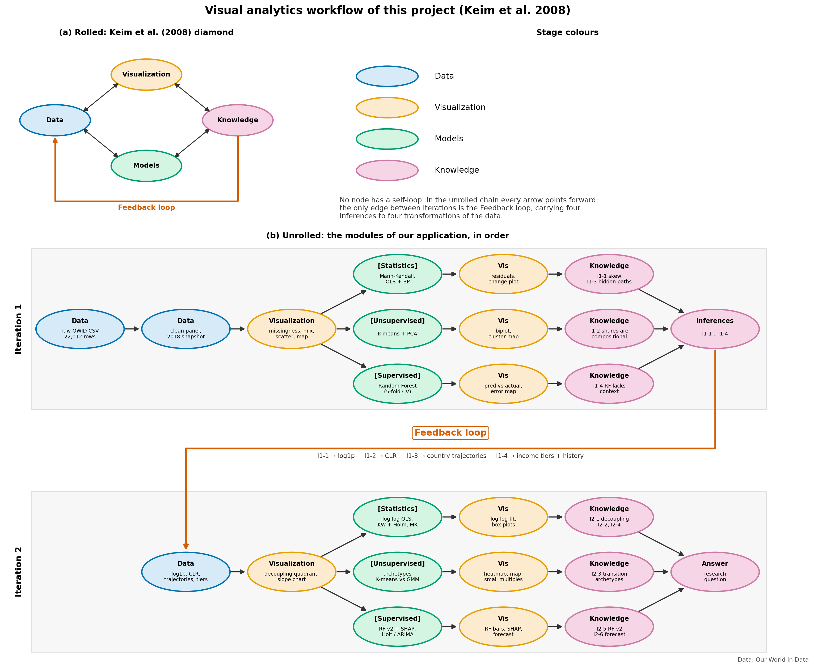

**Figure 1.** Unrolled visual analytics workflow: iteration 1 and iteration 2 rows of the Keim et al. diamond, joined by the edge labelled 'Feedback loop' with the four inference -> transformation pairs. *Why this chart:* Unrolling the diamond shows the order of modules and makes the feedback loop a single, labelled edge, as the brief requires, instead of a cycle drawn back onto itself.

**Table 2.** Modules of the workflow and the rationale for each.

| Module | What it does | Why |
|---|---|---|
| D1 Data | drop aggregates; 2000-2021 window; within-country interpolation; coverage rule | A clean country panel is the precondition for every count, map and model. |
| V1 Visualization | missingness, global mix, distributions, scatter, correlations, map, change | See the data's shape, skew, gaps and geography before modelling it. |
| M1 Models | [Statistics] Mann-Kendall, OLS + Breusch-Pagan; [Unsupervised] K-means + PCA; [Supervised] Random Forest | Baseline models on raw scales, so their failures can be diagnosed. |
| K1 Knowledge | I1-1..I1-4 | Each inference names a defect of the raw representation. |
| Feedback loop | log1p; CLR; trajectories; income tiers + history | Each transformation answers one inference (Section 6). |
| D2 Data | one row per country; log and CLR columns; pre-2019 model table | The unit of analysis becomes a country's path. |
| V2 Visualization | decoupling quadrant, tier box plots, log-log fit, slope chart, archetype heatmap / map / small multiples, forecasts | Views of change, not of a single year. |
| M2 Models | [Statistics] log-log OLS (HC3), Kruskal-Wallis + Holm, Mann-Kendall; [Unsupervised] K-means vs diagonal GMM; [Supervised] RF v2, Holt / ARIMA | Re-model on the new representation with the same validation design. |
| K2 Knowledge | I2-1..I2-6 | Answers to the research question, including negative results. |

## 4. Data handling (beyond A1)

A1 used complete-case panels and no imputation. A3 keeps every country it defensibly can and documents each step (`results/data_notes.md`):

- 87 entities without an ISO code were dropped (aggregates, plus Kosovo, a real country without an ISO code in this file).
- Analysis window 2000-2021: 2022 covers only about half the countries.
- GDP and energy_per_gdp end in 2018; GDP-based analysis stops there.
- Producer columns list only main producers from 2017; countries producing in 2016 but blank the next year: {'oil': 50, 'gas': 46, 'coal': 31}. Producer features therefore use data up to 2016 only, and the raw producer columns are removed.
- Missing cells in the core columns: 0 internal gaps, so interpolation filled 0 cells. All missingness is structural.
- Mix closure: 153 structural-zero cells filled in 7 countries; 22 rows rescaled to 100 (Chile only).
- Coverage rule dropped 14 countries with >30% missing grid data, leaving 205 countries.
- Balanced panel for world totals: 201 countries.

After these steps the clean panel has 4,490 country-years for 205 countries; world totals use a balanced panel of 201 countries so that a country entering the data cannot look like growth. Sanity checks: 0 duplicate country-years, 0 negative cells, mix sums between 99.7% and 100.4%.

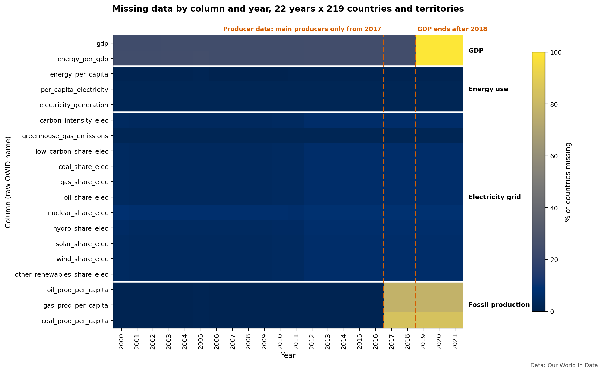

**Figure 2.** Percent of the 219 countries and territories missing each core column in each year 2000-2021, marking the 2017 producer-data break and the end of GDP after 2018. *Why this chart:* A column-by-year heatmap shows the structure of missingness (whole blocks versus scattered cells) for every variable at once, which a table of ~400 numbers cannot.

## 5. Iteration 1: the raw 2018 snapshot

Iteration 1 deliberately uses the data as it comes: one year (2018, the last year with GDP), raw units and raw percentage shares. Its purpose is to find out what this representation gets wrong.

### 5.1 Visual exploration

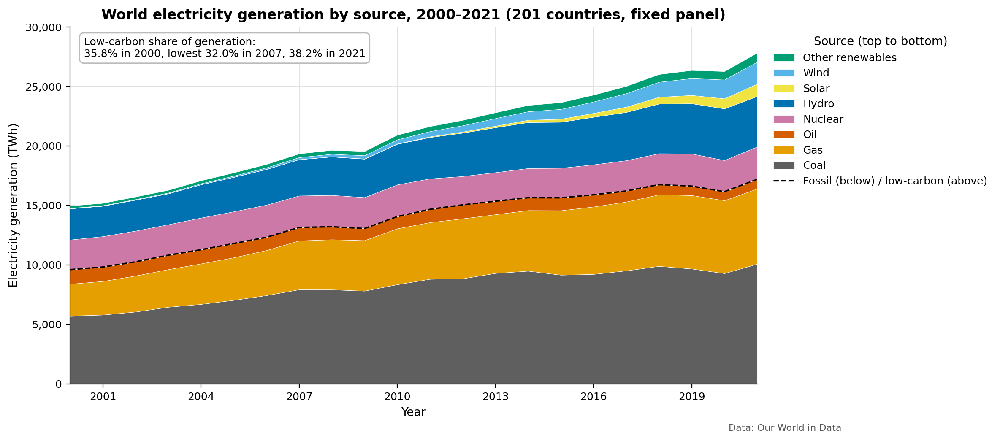

**Figure 3.** World electricity generation by source 2000-2021, summed over a fixed panel of countries, with the fossil/low-carbon boundary and the low-carbon share. *Why this chart:* A stacked area shows both the total and each source's contribution over time, so growth in total demand and the shift between sources are visible in one view.

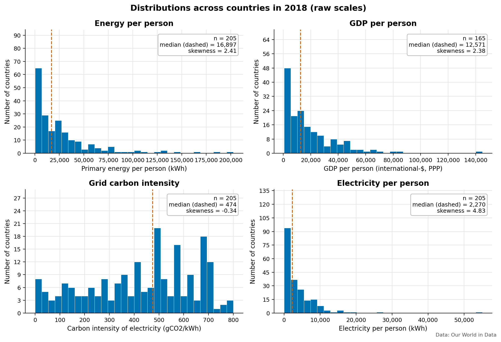

**Figure 4.** Histograms of energy, GDP and electricity per person and grid carbon intensity across countries in 2018, on raw scales, with median and skewness. *Why this chart:* Histograms show the shape of each distribution (skew, long tails, outliers), which decides whether raw scales are suitable for distance-based models and OLS.

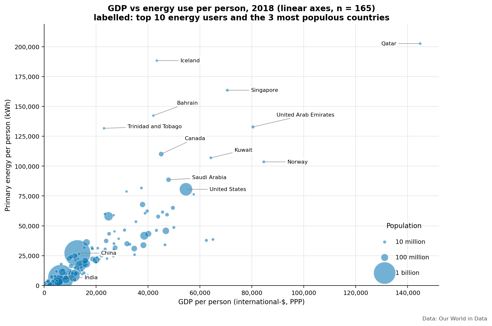

**Figure 5.** GDP per person vs primary energy per person in 2018 on linear axes, bubble area = population; top-10 energy users and the 3 most populous countries labelled. *Why this chart:* A scatter is the standard view of a relationship between two quantities; bubble size adds population, so the reader sees that the axes are set by a few small states while most people live in the crowded bottom-left corner.

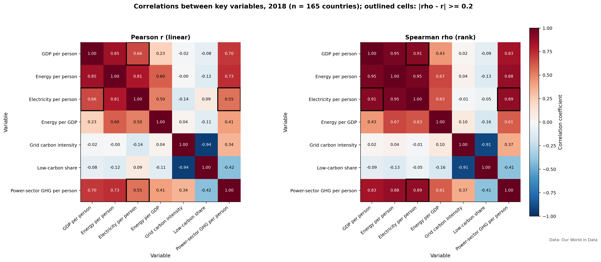

**Figure 6.** Pearson and Spearman correlation matrices of 7 key variables in 2018 (same countries), with cells where the two differ by at least 0.2 outlined. *Why this chart:* Side-by-side annotated heatmaps make the two coefficient matrices directly comparable cell by cell; outlining large gaps points to non-linearity and outliers.

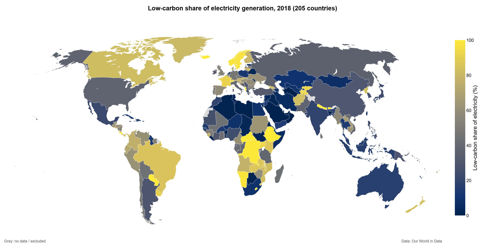

**Figure 7.** Share of each country's electricity from nuclear and renewables in 2018, on a fixed 0-100% scale; excluded countries in grey. *Why this chart:* A choropleth shows the spatial pattern of the energy transition (regional clusters such as hydro-rich South America and fossil-based Middle East) that a table or bar chart would hide.

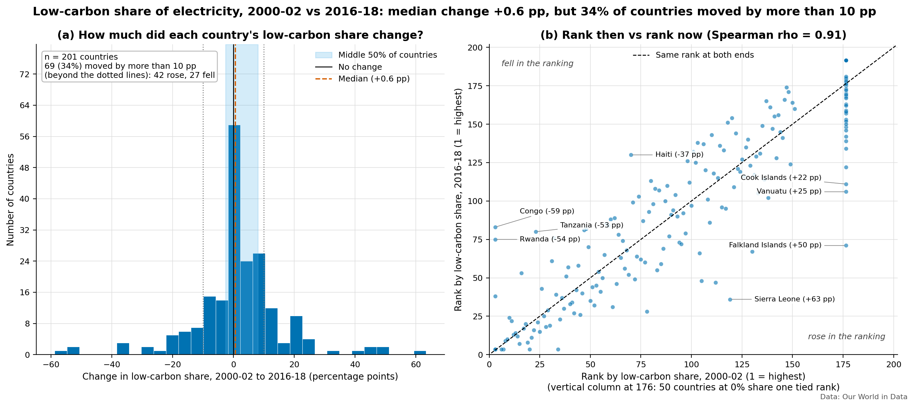

**Figure 8.** Each country's change in low-carbon electricity share between 2000-02 and 2016-18 (histogram, with the +/- threshold for a large change) and its rank at both endpoints (rank-rank scatter), top movers labelled. *Why this chart:* The histogram shows how large changes are and in which direction; the rank-rank scatter shows whether countries keep their positions (diagonal) or overtake each other, which is exactly what a single-year snapshot cannot show.

### 5.2 [Statistics] Trend, correlation and a raw-scale regression

GDP and energy per person are strongly associated in 2018 (Pearson r = 0.85, Spearman ρ = 0.95, n = 165); the gap between the two coefficients is a first sign that a few extreme countries drive the linear measure. The global low-carbon share of electricity has no significant monotonic trend over 2000-2021 (Mann-Kendall p = 0.367; Hamed-Rao p = 0.576, which corrects for autocorrelation [4]; Sen's slope [5] +0.09 pp/yr).

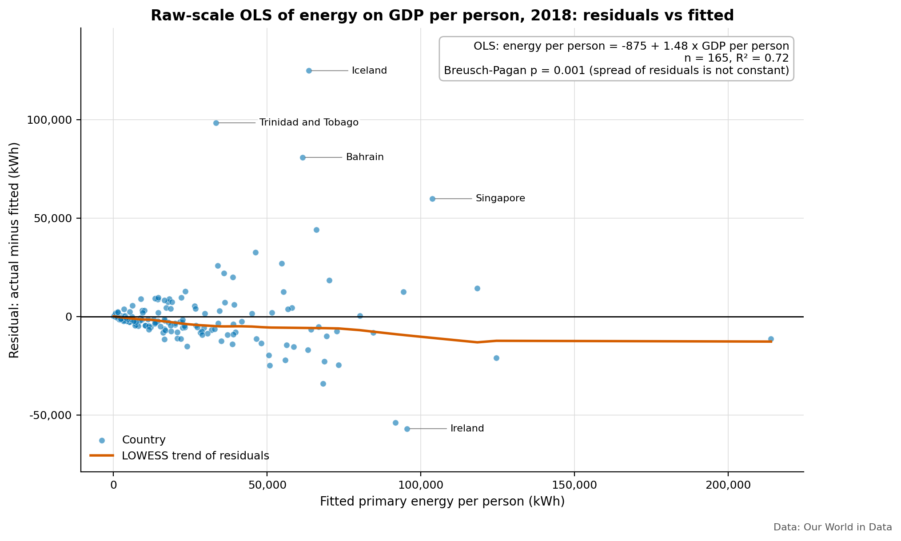

**Figure 9.** Residuals against fitted values for the raw-scale OLS of energy per person on GDP per person (2018), with a LOWESS trend and the 5 largest residuals labelled. *Why this chart:* The residual-vs-fitted plot is the standard regression diagnostic: a funnel shows heteroscedasticity and a curved trend shows non-linearity, both of which a single R-squared hides.

> **I1-1.** On raw scales the per-person variables are strongly right-skewed (skewness: Energy per person 2.41, GDP per person 2.38, Electricity per person 4.83). A straight-line OLS of energy on GDP per person is heteroscedastic (Breusch-Pagan p = 0.001, R² = 0.72), and its 4 largest residuals are small-population economies (all under 6 M people): Iceland (0.4 M people), Trinidad and Tobago (1.5 M people), Bahrain (1.5 M people), Singapore (5.8 M people). Only Iceland is below the 1 M small-state cut-off and only Trinidad and Tobago and Bahrain produced fossil fuels in 2016, so these are small, energy-intensive economies rather than the 'small producer states' the plan expected. A handful of such countries dominate distances, fits and axes on raw scales. **Triggers the feedback loop.**
>
> *Evidence:* iter1_distributions.png, iter1_gdp_vs_energy_linear.png, iter1_ols_residuals.png; results/iter1_skew.json, results/iter1_ols.json, results/iter1_ols_residuals.csv

> **I1-3.** Summaries of the low-carbon share of electricity look flat. Between 2000-02 and 2016-18 the median country changed by +0.6 pp (middle half -2.6 to +8.0 pp), and the global share of the balanced panel (35.8% in 2000, lowest 32.0% in 2007, 38.2% in 2021) has no significant monotonic trend (Mann-Kendall tau = 0.14, p = 0.367; Hamed-Rao p = 0.576; Sen's slope +0.09 pp/yr). These summaries hide large moves in opposite directions: 69 of 201 countries (34%) moved by more than 10 pp, 42 up (largest: Sierra Leone 11.2% -> 74.5%, Denmark 16.1% -> 66.3%, Falkland Islands 0.0% -> 50.0%, Cambodia 7.0% -> 53.3%) and 27 down (largest: Congo 100.0% -> 41.2%, Rwanda 100.0% -> 45.6%, Tanzania 95.5% -> 43.0%, Ghana 82.4% -> 45.1%). The ranking is broadly kept (Spearman rho = 0.91), yet the median country moved 15 places. The plan's 'large change' therefore holds for 34% of countries, not for the typical one: a 2018 snapshot cannot tell a country that rose to its level from one that fell to it or stayed there. **Triggers the feedback loop.**
>
> *Evidence:* iter1_change_2000_2018.png, iter1_global_mix_area.png, iter1_lowcarbon_choropleth_2018.png; results/iter1_change_summary.json, results/iter1_change.csv, results/iter1_mk_global.json, results/global_lowcarbon_share.csv

### 5.3 [Unsupervised] K-means and PCA on raw shares

K-means on the 8 standardised mix shares and 3 intensities (n = 205) picks k = 8 by a rule fixed before fitting (highest silhouette among the k whose every cluster has >= 5 countries (ties -> smaller k)); mean silhouette 0.36 ('weak' structure [8]). The clusters largely re-label each country's dominant source (ARI 0.66).

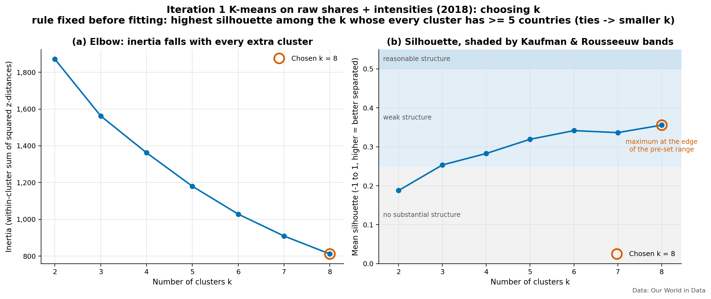

**Figure 10.** K-means inertia (elbow) and mean silhouette for k = 2..8 on the standardised 2018 mix shares and intensities, with the k chosen by the pre-set rule marked. *Why this chart:* Line charts over k are the standard way to compare cluster counts; showing the elbow and the silhouette side by side, with silhouette strength bands shaded, makes the choice of k checkable instead of a judgement call.

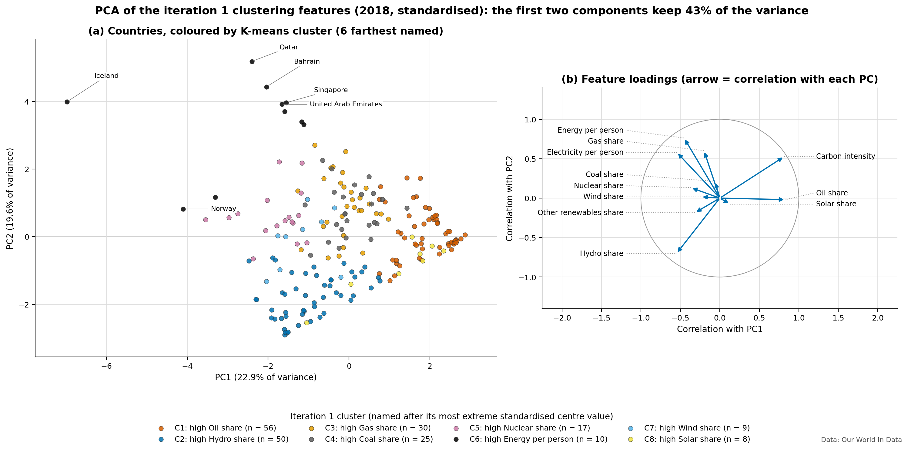

**Figure 11.** Countries on the first two principal components of the iteration 1 clustering features, coloured by K-means cluster, next to a correlation circle of the feature loadings. *Why this chart:* A PCA biplot is the usual way to see 11-dimensional clusters in 2-D and to read which features separate them; splitting points and arrows into two panels with the same axes keeps both readable.

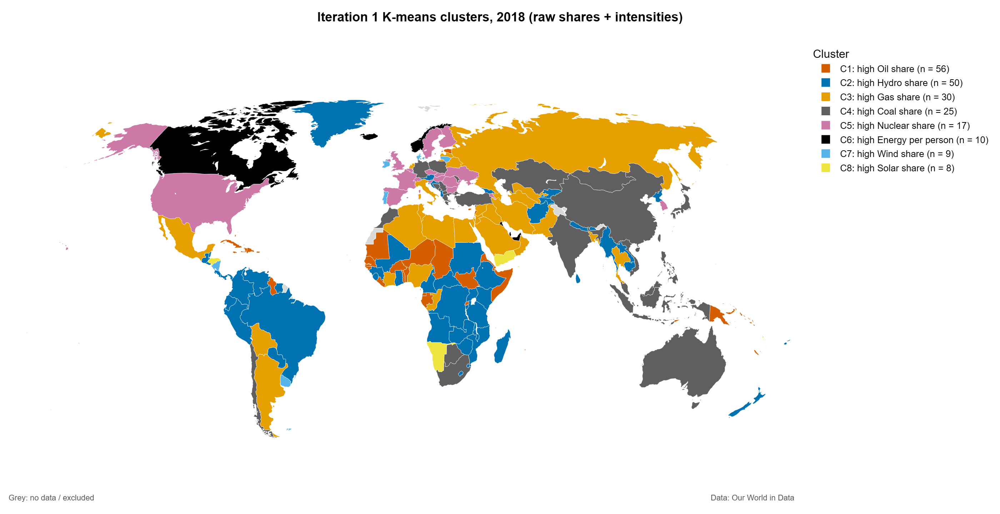

**Figure 12.** Each country's iteration 1 K-means cluster (k = 8) on a world map. *Why this chart:* A categorical choropleth shows whether clusters follow geography (regional resource endowments) or cut across it, which a scatter plot cannot show.

> **I1-2.** Euclidean K-means on the raw shares and intensities gives k = 8 (the largest k tried; silhouette has no clear peak) with a mean silhouette of 0.36, which is 'weak' structure (Kaufman & Rousseeuw). 7 of 8 clusters are named after one source, and the clusters largely re-label each country's dominant source (ARI = 0.66). The shares are a composition: every row sums to 100 (within ±0.004), the 8 shares have rank 7 (one dimension is redundant) and 64% of their pairwise correlations are negative, partly forced by the fixed sum. The smallest cluster (C8, high Solar share, n = 8: Cook Islands; Honduras; Namibia; Palestine; Samoa; Tonga; Vanuatu; Yemen) is split off by a share with a small spread (sd 4.1 pp, centre 17.3%), although 88% of its grids are mostly Oil: z-scoring inflates small absolute differences in minor sources. Cluster C6 (high Energy per person, n = 10) is defined by scale, not by the mix: it puts Iceland (28 gCO2/kWh) with Brunei (500 gCO2/kWh). PC1 (23% of variance) is driven by Oil share, Carbon intensity, Hydro share. Raw shares in Euclidean space therefore group countries by their largest source and by scale, not by how their mix is changing. **Triggers the feedback loop.**
>
> *Evidence:* iter1_kmeans_k_selection.png, iter1_kmeans_pca.png, iter1_kmeans_map.png; results/iter1_kmeans.json, results/iter1_clusters.csv, results/iter1_composition_checks.json, results/iter1_pca.json

### 5.4 [Supervised] Random Forest for grid carbon intensity

A Random Forest (500 trees, 5-fold cross-validation, n = 165) predicts 2018 grid carbon intensity from income, energy use, population and 2016 fossil production. **Leakage guard:** carbon intensity is computed from the electricity mix, so no mix share, mix-derived or emissions column may be a feature; `models.assert_no_leakage` checks every feature name before each fit. Result: R² 0.02 ± 0.10 and MAE 167 gCO2/kWh, against 177 for a mean predictor.

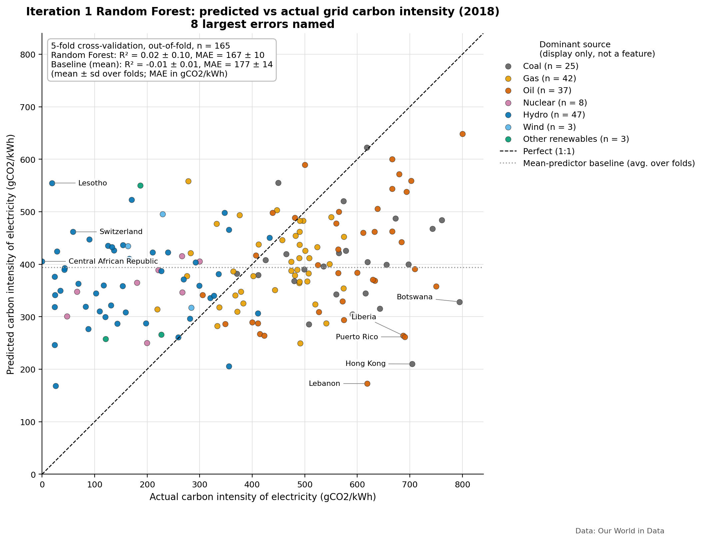

**Figure 13.** Out-of-fold Random Forest predictions of 2018 grid carbon intensity against the actual values, with the 1:1 line, the mean-predictor baseline, cross-validated metrics and the 8 largest errors named; colour = dominant source (display only). *Why this chart:* A predicted-vs-actual scatter shows both overall fit (distance from the 1:1 line) and which countries fail; colouring by a variable the model never saw reveals systematic error that one R-squared value hides.

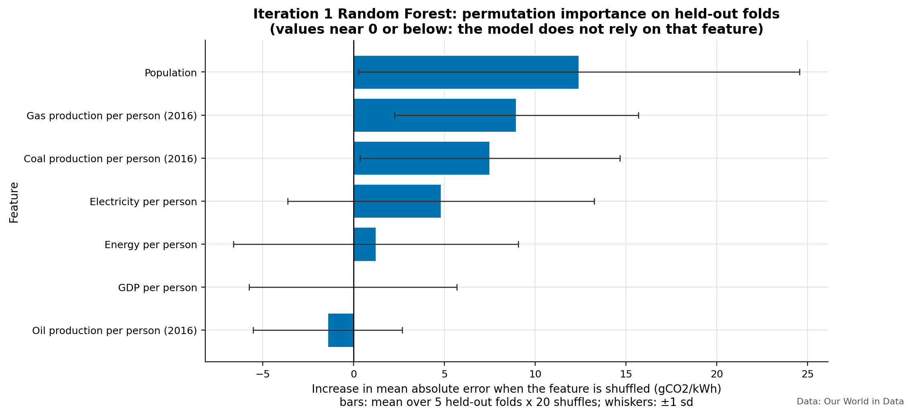

**Figure 14.** Permutation importance of each Random Forest feature on held-out folds: the mean rise in MAE (gCO2/kWh) when the feature is shuffled, with ±1 sd whiskers. *Why this chart:* Sorted horizontal bars compare a handful of features on one scale and leave room for long names; the error bars show whether an importance is distinguishable from 0.

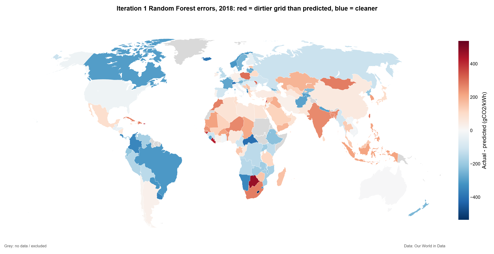

**Figure 15.** Out-of-fold Random Forest residual (actual minus predicted carbon intensity, 2018) for each of the countries in the RF set, on a diverging scale centred at 0. *Why this chart:* A diverging choropleth centred at zero shows whether errors cluster in space (e.g. hydro-rich regions under one colour), which a residual table cannot show.

> **I1-4.** The iteration 1 Random Forest barely beats a mean predictor: cross-validated R² = 0.02 ± 0.10 (baseline -0.01), MAE = 167 vs 177 gCO2/kWh for the baseline. Its errors are systematic by the dominant source, which it is not allowed to see: median residual (actual - predicted, gCO2/kWh) Hydro -205, Nuclear -159, Gas +59, Oil +151, Coal +185 (Kruskal-Wallis p < 0.001, significant): hydro- and nuclear-dominated grids are predicted too dirty and gas-, oil- and coal-dominated grids too clean. The errors do not concentrate by income or size: median absolute error by 2018 GDP quartile Q2 126, Q3 133, Q4 (richest) 149, Q1 (poorest) 184 (p = 0.379, not significant), and small state 123, other 146 (p = 0.633, not significant). Largest errors: Lesotho (Hydro, -536), Hong Kong (Coal, +494), Botswana (Coal, +466), Lebanon (Oil, +446), Puerto Rico (Oil, +429). Only Population, Gas production per person (2016) and Coal production per person (2016) have a mean rise in held-out MAE, when shuffled, larger than its sd, and the largest rise (12 gCO2/kWh) is small next to the MAE; GDP per person and Oil production per person (2016) add nothing on average. Single-year income, energy-use and producer features carry little information about how a grid is built; iteration 2 tests whether history and context add any. **Triggers the feedback loop.**
>
> *Evidence:* iter1_rf_pred_vs_actual.png, iter1_rf_importance.png, iter1_rf_residual_map.png; results/iter1_rf_metrics.json, results/iter1_rf_errors.csv, results/iter1_rf_error_groups.json

## 6. The feedback loop: from inferences to a transformed dataset

Each iteration 1 inference names a defect, and each defect gets one transformation (Table 3). Together they change the scale of the variables, the geometry of the mix and, most importantly, the unit of analysis.

**Table 3.** Inference → transformation.

| Inference | Transformation | What changes | Before/after figure |
|---|---|---|---|
| I1-1 | log1p of the skewed variables; small-state flag (never dropped) | scale | loop_skew_before_after.png |
| I1-2 | centred log-ratio (CLR) of the 8 mix shares, eps sensitivity | geometry of the mix (percentages -> log-ratios) | loop_clr_before_after.png |
| I1-3 | country-year panel reshaped into one row per country (trajectories) | unit of analysis | loop_before_after_table.png |
| I1-4 | income tiers from 2000-02 GDP; growth, decoupling, producer history | new context features (no mix-derived feature) | loop_before_after_table.png |

**Why this is a significant transformation.** The unit of analysis changes from *a country in one year (2018 snapshot)* to *a country's path, 2000-2018 (one row per country)*: 4,490 country-year rows become 162 country rows, and 16 snapshot features become 26 columns, most built from several years. The largest absolute skewness falls from 4.83 to 0.75. The mix changes from 8 shares in % (each row sums to 100) to 8 CLR log-ratios (each row sums to 0).

**CLR and its ε.** Shares that sum to 100% are compositional: their correlations are partly forced by the constant sum, and Euclidean distances on raw percentages overweight the large sources [3]. The centred log-ratio clr(x) = log(x + ε) − mean(log(x + ε)) compares ratios between sources. ε = 0.1 pp handles zero shares; the result is not sensitive to it (ε = 0.01: silhouette 0.29, ARI 0.67, ε = 1: silhouette 0.28, ARI 0.68; silhouette at the default 0.27).

**Two trajectory tables.** A descriptive table uses endpoints up to 2019-21 for visuals; a model table uses no year after 2018, and its builder raises an error if given later data, so the Random Forest v2 and the 2019-21 forecast cannot see the future.

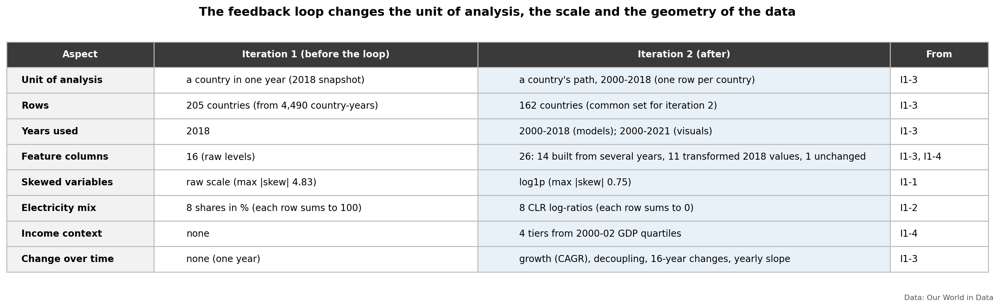

**Figure 16.** Before/after table of the feedback loop: unit of analysis, rows, years, feature columns, scale, mix representation, income context and time information, each linked to the iteration 1 inference that triggered it. *Why this chart:* A two-column table states exactly what changed in the data, with computed counts; it is the clearest proof that the loop transformed the data rather than restyled it.

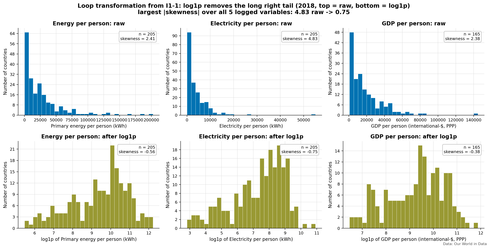

**Figure 17.** Histograms of energy, electricity and GDP per person in 2018, raw (top) and after log1p (bottom), with n and skewness from results/loop_skew.csv. *Why this chart:* Paired histograms on the same countries show the shape change directly: a long right tail on the raw scale becomes a roughly symmetric distribution after log1p.

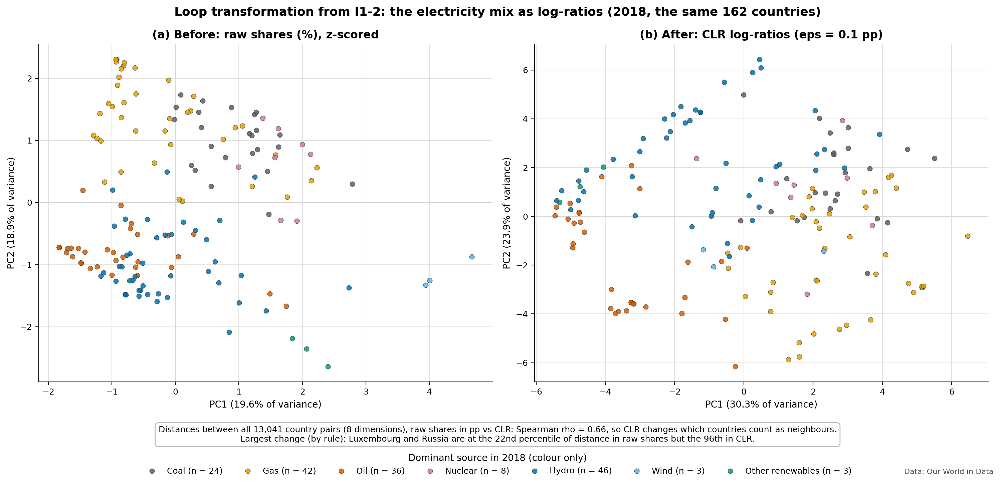

**Figure 18.** PCA of the 2018 electricity mix for the iteration 2 countries: z-scored raw shares (left) vs CLR log-ratios (right), coloured by dominant source, with the pair whose distance rank rises most joined in both panels. *Why this chart:* Side-by-side PCA scatters of the same countries show how the representation changes the geometry: which countries are neighbours, and how much variance the first two components hold.

**Table 4.** Skewness before and after log1p (2018).

| Variable | n | Skew (raw) | Skew (log1p) |
|---|---|---|---|
| energy_per_capita | 205 | 2.414 | -0.562 |
| per_capita_electricity | 205 | 4.832 | -0.753 |
| gdp_pc | 165 | 2.381 | -0.378 |
| energy_per_gdp | 165 | 2.215 | 0.719 |
| ghg_pc | 205 | 1.778 | 0.689 |

## 7. Iteration 2: trajectories, archetypes and re-modelling

### 7.1 [Statistics] Decoupling of energy from GDP, by income tier

Decoupling = growth of GDP per person minus growth of energy per person (CAGR, 2000-02 to 2016-18). *Absolute* decoupling means GDP rose while energy per person fell; *relative* means both rose but energy more slowly.

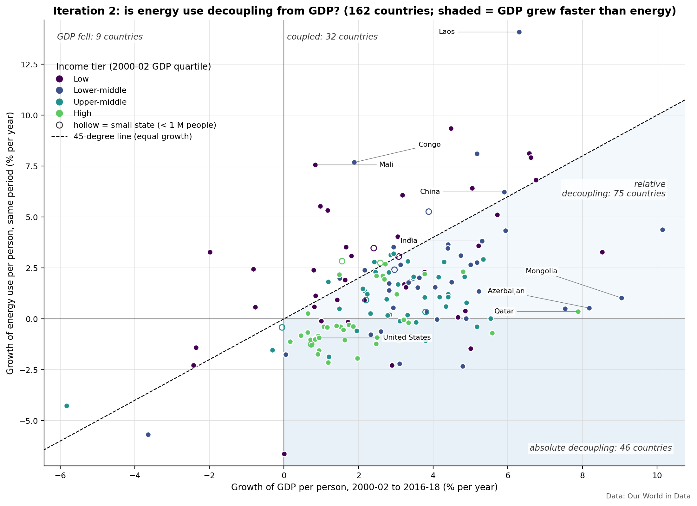

**Figure 19.** Each country's yearly growth of GDP per person vs energy use per person (2000-02 to 2016-18), with the 45-degree and zero lines, the decoupling classes and their counts; colour = data-derived income tier, hollow = small state. *Why this chart:* A growth-vs-growth scatter turns decoupling into geometry: the 45-degree line separates relative decoupling from coupling and the zero line marks absolute decoupling, so the class of every country is visible at once.

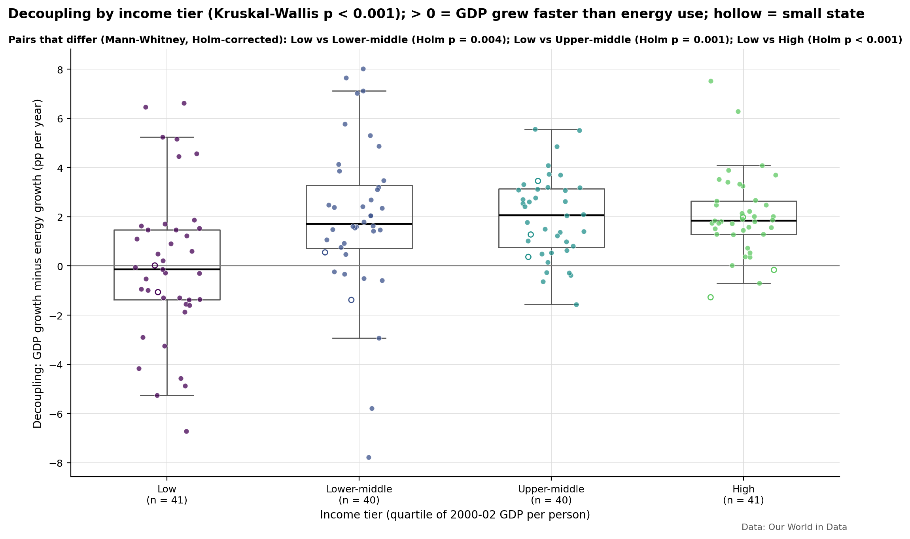

**Figure 20.** Decoupling (GDP growth minus energy growth, pp per year) per income tier: box plot plus every country, n per tier, the Kruskal-Wallis p and the Holm-corrected pairs that differ. *Why this chart:* A box plot with the points overlaid shows each tier's median and spread and every country behind it, which matters with ~40 countries per tier; the test results sit on the same figure.

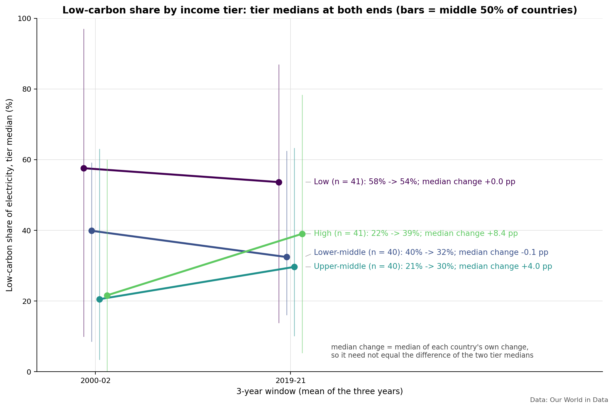

**Figure 21.** Median low-carbon share of electricity per income tier in 2000-02 and 2019-21, with the interquartile range at each end and the median per-country change. *Why this chart:* A slope chart compares four groups at two time points with one line each: the direction and steepness of each line is the tier's change, and crossings are immediately visible.

> **I2-1.** Energy use is decoupling from GDP, but mainly outside the poorest tier. Of 162 countries, 46 decoupled absolutely (GDP per person up, energy per person down) and 75 relatively; 29 of 41 High-tier countries decoupled absolutely, while the Low tier is mostly coupled (17 of 41). Decoupling differs by tier (Kruskal-Wallis p < 0.001), but only because the Low tier differs from each other tier (Holm p = 0.004, = 0.001, < 0.001); the other three tiers do not differ from each other (Holm p >= 1.00). The High tier's median low-carbon share rose 22% -> 39% (median change +8.4 pp) while the Low tier's median change is +0.0 pp. Tiers come from 2000-02 GDP, so regression to the mean inflates measured growth in the lowest tier; the comparison is descriptive, not causal.
>
> *Evidence:* iter2_decoupling_quadrant.png, iter2_decoupling_by_tier.png, iter2_slope_lowcarbon_by_income.png; results/iter2_decoupling_counts.csv, results/iter2_kw.json, results/iter2_pairwise.csv, results/iter2_tier_lowcarbon.csv

### 7.2 [Statistics] Income elasticity of energy on log scales

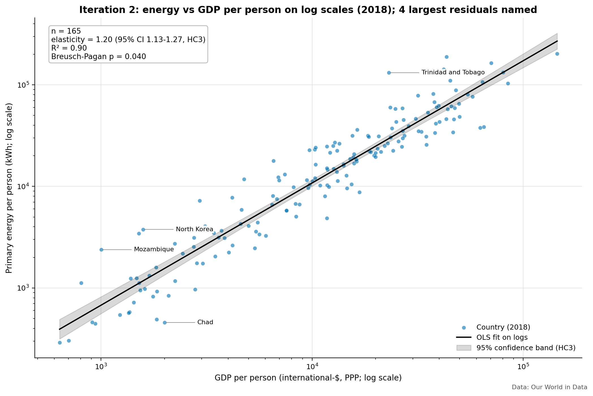

**Figure 22.** Energy vs GDP per person (2018) on log-log axes with the OLS fit, its HC3 95% confidence band, the elasticity with CI, R-squared and Breusch-Pagan p; the largest residuals are named. *Why this chart:* Log axes turn a multiplicative relationship into a straight line whose slope is the elasticity, and spread the countries that crowded the corner of the raw-scale plot.

> **I2-2.** On log-log axes energy per person rises more than proportionally with GDP per person across countries: elasticity 1.20 (95% CI 1.13-1.27, HC3, n = 165), so a country with 10% higher GDP per person uses about 12% more energy per person. The log model explains more (R² 0.72 -> 0.90) and is less heteroscedastic (Breusch-Pagan p = 0.001 -> = 0.040), but not fully homoscedastic. This cross-sectional elasticity > 1 coexists with absolute decoupling over time in rich countries (I2-1): the cross-section compares countries, the trajectory follows each country, and neither is a causal effect of income.
>
> *Evidence:* iter2_loglog_gdp_energy.png, iter1_gdp_vs_energy_linear.png; results/iter2_loglog.json, results/iter2_ols_comparison.csv

### 7.3 [Unsupervised] Transition archetypes

Countries are clustered on 17 standardised features: 9 trajectory features (growth, decoupling, change in the low-carbon, coal and solar+wind shares, carbon-intensity change, slope) and the 8 CLR mix coordinates. Small states (< 1 M people) are left out of the fit and assigned to the nearest centroid afterwards. K-means and a diagonal-covariance Gaussian mixture are compared for k = 3..7 by a rule fixed in advance (highest silhouette among the k (and methods) whose every cluster has >= 5 countries; GMM is used only if its BIC-best k also meets the size rule and its silhouette beats K-means (ties -> K-means, smaller k)); K-means with k = 5 is chosen. Archetype names follow a rule too: the largest positive CLR source plus the direction of the archetype's Mann-Kendall trend.

**Table 5.** The archetypes.

| Archetype | Name (rule-based) | Countries | Sen slope (pp/yr) | Largest members |
|---|---|---|---|---|
| A1 | Gas grids, low-carbon share flat | 45 | +0.03 | India, Indonesia, Pakistan, Nigeria |
| A2 | Hydro grids, low-carbon share flat | 43 | +0.14 | Brazil, Ethiopia, Democratic Republic of Congo, Turkey |
| A3 | Oil grids, low-carbon share rising | 30 | +0.62 | Yemen, Niger, Syria, Cambodia |
| A4 | Coal grids, low-carbon share rising | 25 | +1.37 | China, United States, Germany, United Kingdom |
| A5 | Hydro grids, low-carbon share falling | 19 | -1.36 | Vietnam, Tanzania, Peru, Ghana |

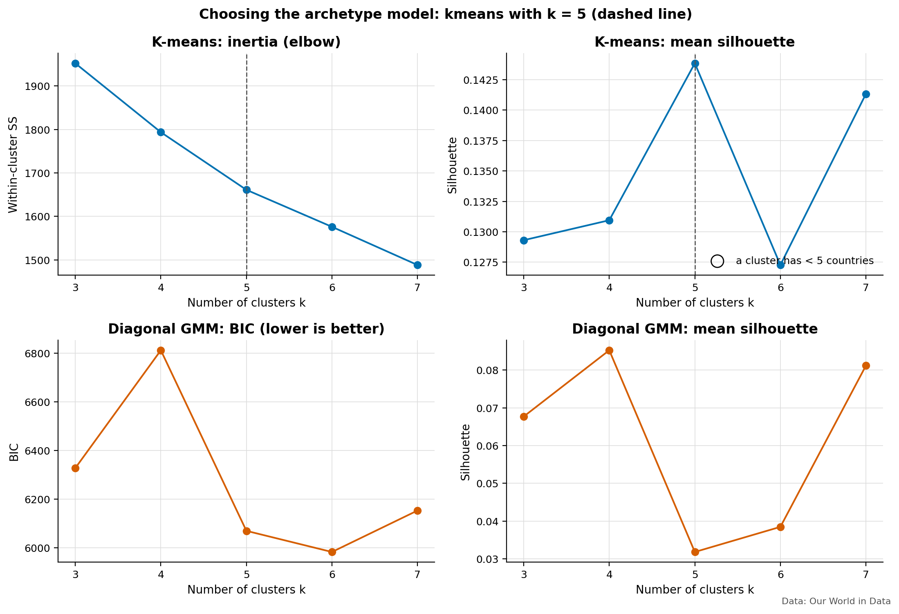

**Figure 23.** K-means inertia and silhouette and diagonal-GMM BIC and silhouette for k = 3..7 on the archetype matrix; circled points have a cluster under 5 countries. *Why this chart:* Small multiples put the four model-selection criteria on one k axis, so the choice follows the documented rule rather than one favourite curve.

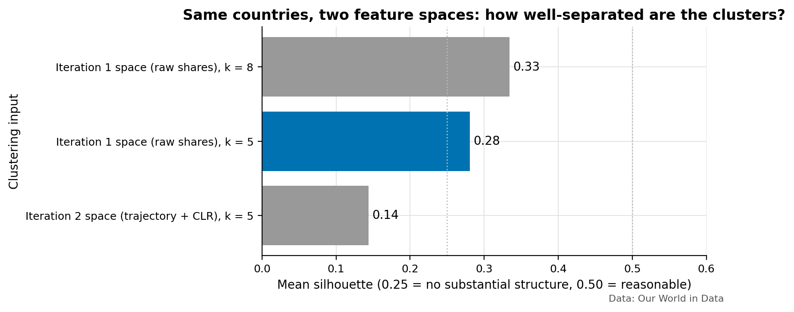

**Figure 24.** Mean silhouette of K-means on the same 152 countries in the iteration 1 feature space (at k = 8 and at the iteration 2 k) and in the iteration 2 space. *Why this chart:* A bar per feature space on one axis answers a single question: did the transformation make clusters better separated? Reference lines mark the Kaufman-Rousseeuw cut-offs.

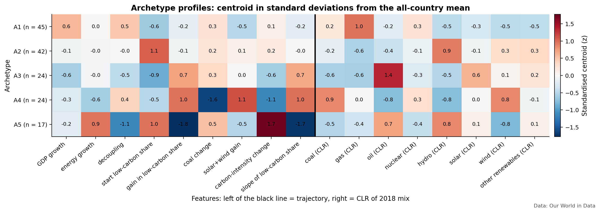

**Figure 25.** Standardised centroid of every archetype on the 9 trajectory and 8 CLR features. *Why this chart:* A diverging heatmap centred at 0 shows at a glance which features separate which archetype, and the black line splits trajectory features from mix features.

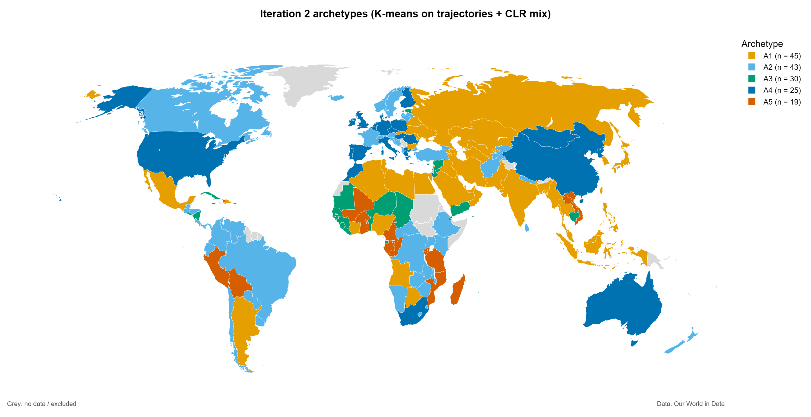

**Figure 26.** Archetype of every country in the iteration 2 set (small states assigned post hoc). *Why this chart:* A categorical choropleth checks whether the archetypes are geographic blocs or cut across regions, which the heatmap cannot show.

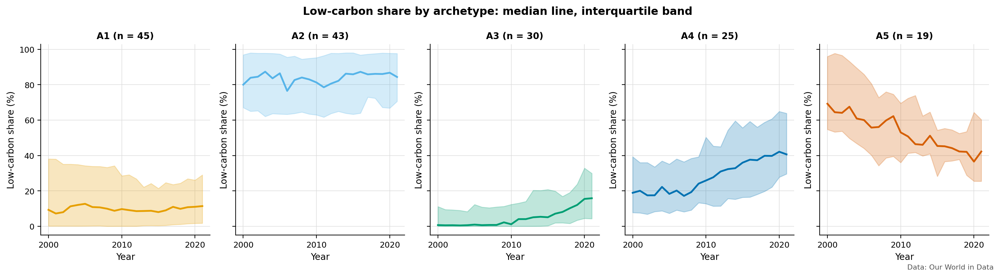

**Figure 27.** Median and interquartile band of the low-carbon share of electricity, 2000-2021, per archetype. *Why this chart:* One panel per archetype on a shared y axis shows each group's path without the overplotting of 160 lines, and makes levels directly comparable.

> **I2-3.** K-means on trajectory + CLR features gives 5 archetypes: A1 Gas grids, low-carbon share flat (n = 45, Sen slope +0.03 pp/yr, e.g. India, Indonesia, Pakistan, Nigeria); A2 Hydro grids, low-carbon share flat (n = 43, Sen slope +0.14 pp/yr, e.g. Brazil, Ethiopia, Democratic Republic of Congo, Turkey); A3 Oil grids, low-carbon share rising (n = 30, Sen slope +0.62 pp/yr, e.g. Yemen, Niger, Syria, Cambodia); A4 Coal grids, low-carbon share rising (n = 25, Sen slope +1.37 pp/yr, e.g. China, United States, Germany, United Kingdom); A5 Hydro grids, low-carbon share falling (n = 19, Sen slope -1.36 pp/yr, e.g. Vietnam, Tanzania, Peru, Ghana). A4 (Coal grids, low-carbon share rising) is decarbonising fastest (+1.37 pp/yr, Hamed-Rao p < 0.001) and A5 (Hydro grids, low-carbon share falling) is moving backwards (-1.36 pp/yr). The partition is reproducible (ARI across 20 seeds: mean 0.82, min 0.74) but not well separated: silhouette 0.14 ('no substantial' structure), lower than K-means on the iteration 1 raw features for the same countries (0.33 at k = 8, 0.28 at k = 5). Iteration 1 clusters were tighter because they re-labelled the dominant source; the archetypes trade that compactness for groups that differ in the direction of change. They are a useful partition of a continuum, not natural types.
>
> *Evidence:* iter2_k_selection.png, iter2_vs_iter1_silhouette.png, iter2_archetype_profiles.png, iter2_archetype_map.png, iter2_archetype_small_multiples.png; results/iter2_stability.json, results/archetype_names.csv, results/iter2_mk_archetypes.csv

### 7.4 [Statistics] Are fossil producers stuck with dirty grids?

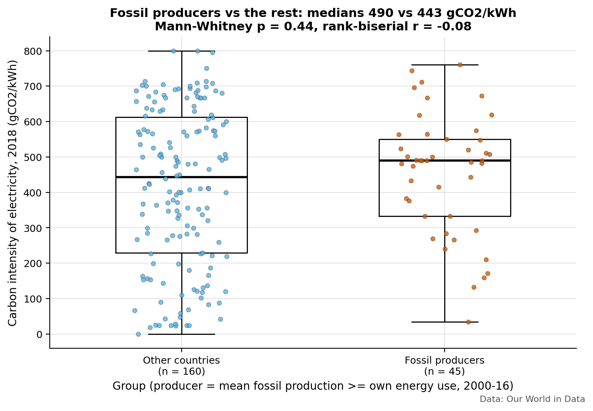

**Figure 28.** Grid carbon intensity in 2018 for fossil producers (production >= own energy use, 2000-16 means) and all other countries, with the Mann-Whitney test. *Why this chart:* A box plot with every country overlaid compares two groups' medians and spreads and shows the exceptions (clean-grid producers) that a bar of means would hide.

> **I2-4.** Fossil producers (fossil production per person >= own energy use, 2000-16; n = 45) and the other 160 countries: median 2018 grid carbon intensity 490 vs 443 gCO2/kWh (Mann-Whitney p = 0.438, rank-biserial r = -0.08). The cleanest producers are Norway (35), Canada (133), Angola (159) gCO2/kWh. The plan's hypothesis that producers are 'stuck' with carbon-intensive grids is not supported: the medians differ by little, the effect size is negligible and the test is not significant. Both groups span almost the whole range, so what a country digs up says little about how it makes electricity. Association only; no causal claim.
>
> *Evidence:* iter2_producers_carbon.png; results/iter2_producers.json

### 7.5 [Supervised] Random Forest v2

RF v2 adds the history and context features asked for by I1-4 to the iteration 1 features and is scored on the same 162 countries and the same folds as a re-scored v1 (3 iteration 1 countries lack trajectory data). The leakage guard is re-run on the new features. A log transform would not change a Random Forest (trees split on ranks), so any change comes from the new features, not from rescaling. Importance is read two ways: held-out permutation importance and SHAP values [13] from a forest refitted on all rows (for explanation only).

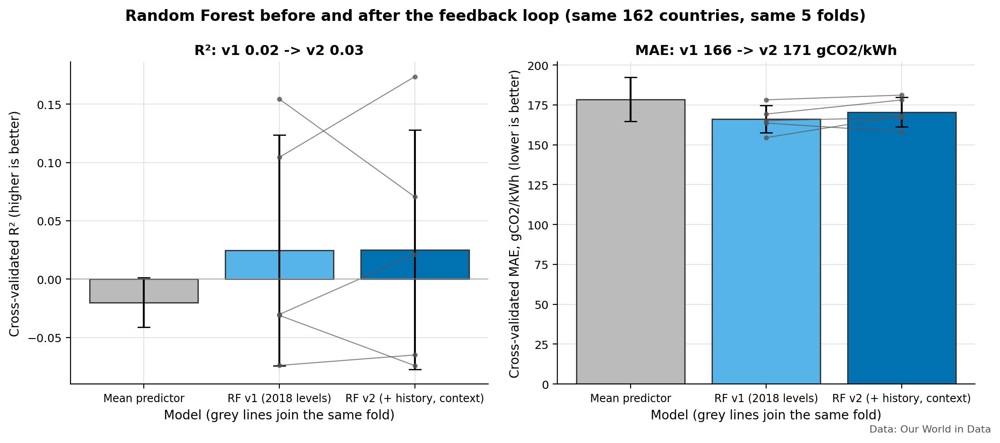

**Figure 29.** Cross-validated R² and MAE of the mean predictor, RF v1 and RF v2 on the same countries and folds (bars = mean, whiskers = fold sd, lines = paired folds). *Why this chart:* Bars with fold error bars show the size of the change against fold-to-fold noise, and the paired lines show whether v2 wins consistently or only on average.

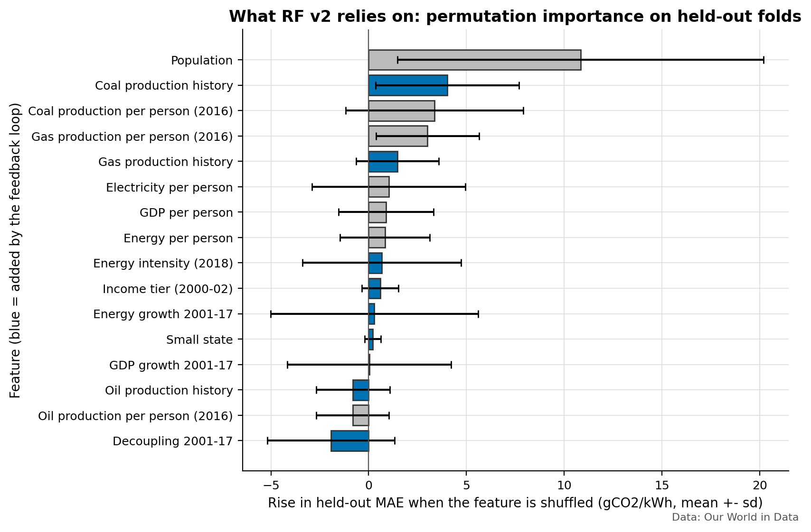

**Figure 30.** Held-out permutation importance of every RF v2 feature (rise in MAE when shuffled). *Why this chart:* A sorted horizontal bar chart ranks features and its error bars show which importances are distinguishable from zero; colour marks the features the loop added.

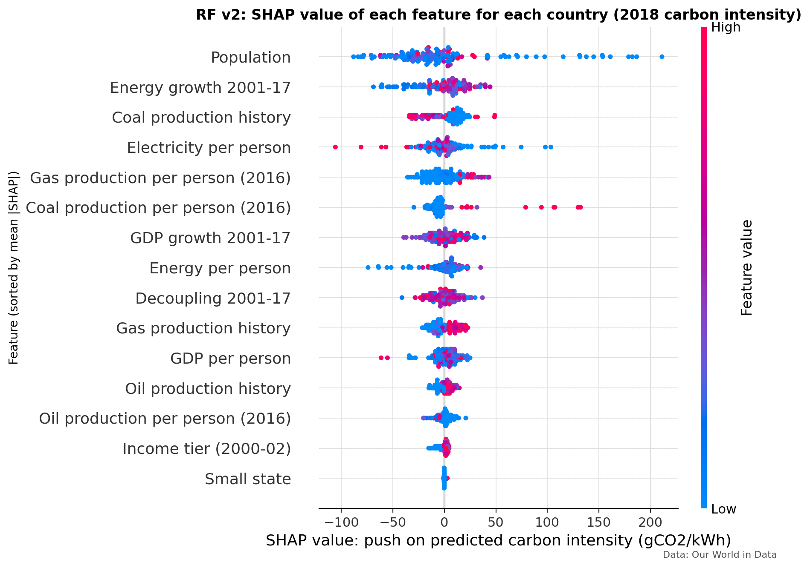

**Figure 31.** SHAP beeswarm for RF v2: one dot per country and feature; position = how much that feature pushed the prediction, colour = the feature's value (red high, blue low). *Why this chart:* A beeswarm shows both how much a feature matters and in which direction its high and low values push the prediction, which a bar of mean importance cannot show.

> **I2-5.** Effect of adding the feedback loop's history and context features to the Random Forest: on the same 162 countries and folds, mean R² goes 0.02 -> 0.03 and MAE 166 -> 170 gCO2/kWh (mean predictor 178); v2 has the lower MAE in 2 of 5 folds (mean paired change +3.4 +- 9.5), so the change is within fold-to-fold noise. Added features whose held-out importance exceeds its sd: Coal production history. Of the 15 countries v1 got most wrong, v2 reduced the error for 11. SHAP puts the largest mean |contribution| (gCO2/kWh) on Population (37), Energy growth 2001-17 (17), Coal production history (15). The I1-4 diagnosis stands: what sets a grid's carbon intensity is its mix (hydro, nuclear, coal), which is banned as a feature to avoid leakage; income, growth and fuel production are weak proxies for it.
>
> *Evidence:* iter2_rf_improvement.png, iter2_rf_importance.png, iter2_shap_summary.png; results/iter2_rf_metrics.json, results/rf_comparison.csv, results/iter2_rf_comparison.json, results/iter2_rf_error_change.csv, results/iter2_shap_values.csv

### 7.6 [Supervised] Forecast vs reality, 2019-2021

The same clustering is re-fitted on the pre-2019 table, and each group's median low-carbon share is forecast from 2000-2018 only (time-based split; the code asserts that training ends in 2018 and the test years are exactly 2019-2021). Holt's linear trend (plain and damped) and ARIMA(1,1,0) are compared with the naive last value.

**Table 6.** Forecast MAE (pp), 2019-2021.

| Group | ARIMA(1,1,0) | Holt | Holt damped | Naive |
|---|---|---|---|---|
| P1: Gas grids | 1.28 | 1.14 | 1.19 | 1.2 |
| P2: Hydro grids | 1.21 | 1.1 | 1.47 | 1.29 |
| P3: Coal grids | 3.45 | 3.27 | 3.66 | 5.7 |
| P4: Oil grids | 3.32 | 2.66 | 2.73 | 2.98 |
| P5: Hydro grids | 1.21 | 5.0 | 1.07 | 1.16 |

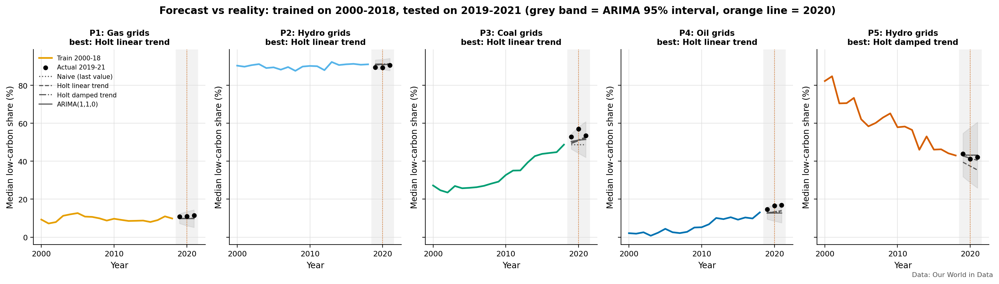

**Figure 32.** Median low-carbon share per pre-2019 group: training years 2000-2018, the four methods' 2019-2021 forecasts, the ARIMA 95% interval and the actual values. *Why this chart:* Small multiples with the training history, forecasts and actual points on one time axis show at a glance whether any method beat the naive last value.

> **I2-6.** Trained on 2000-2018 and tested on 2019-2021, the 5 pre-2019 groups (same method and k as the archetypes; ARI with them 0.79) give mean MAE: Naive (last value) 2.47 pp, Holt linear trend 2.63 pp, Holt damped trend 2.02 pp, ARIMA(1,1,0) 2.09 pp. Against the naive last value (2.47 pp), Holt wins in 4 of 5 groups, damped Holt in 4 and ARIMA(1,1,0) in 2. Electricity generation of the balanced panel changed -0.3% in 2020 (vs +1.3% in 2019); 65% of the 2020 forecast errors are positive (actual share above the forecast), consistent with fossil generation falling more than low-carbon generation when demand dropped, though three test years cannot separate a COVID effect from trend. Group medians are smooth, so errors are small in pp; this says nothing about forecasting single countries.
>
> *Evidence:* iter2_forecast_vs_actual.png; results/iter2_forecast_metrics.csv, results/iter2_covid.json, results/iter2_pre2019_groups.json, results/iter2_group_series.csv

## 8. Discussion

### 8.1 Answer to the research question

*Does getting richer still mean using more energy?* Across countries, yes: energy per person rises slightly more than proportionally with GDP per person (I2-2). Over time, not necessarily: most richer countries cut energy per person while growing (I2-1). The two statements are about different comparisons and are not in conflict.

*Does it mean a dirtier grid?* No clear link. The Random Forest could not predict grid carbon intensity from income, growth or fuel production even after the feedback loop (I1-4, I2-5), and fossil producers are not significantly dirtier (I2-4). What sets a grid's carbon intensity is its mix, which reflects resources and policy choices that income does not capture.

*How are countries moving?* Along a few broad paths (I2-3): coal-based grids (including China, the United States and Germany) gained low-carbon share fastest; a group of hydro-based grids lost share as demand grew faster than hydro capacity; gas- and hydro-based grids were mostly flat. The flat global trend in iteration 1 (I1-3) hides these opposing movements, which is what the feedback loop was built to reveal.

### 8.2 What the feedback loop changed

The loop changed the questions the models could answer more than their scores. Clustering trajectories produced groups that differ in direction of change, at the cost of a lower silhouette than the dominant-source clusters of iteration 1; the supervised model did not improve. Both are reported as found: a feedback loop is a test of a hypothesis about the data, and some of ours were rejected.

### 8.3 Limitations

- GDP ends in 2018, so every income-based analysis stops there.
- OWID's own series contain interpolated and modelled values; we cannot audit them without external data (e.g. Qatar's GDP growth looks implausible and is not used as an example).
- Producer data break after 2016; producer features use 2000-16 only.
- CLR needs a pseudo-count ε for zero shares; results were checked for ε = 0.01, 0.1 and 1.
- Income tiers are data-derived quartiles, not official classifications; tiers set from 2000-02 GDP and growth measured from the same baseline invite regression to the mean.
- About 150-200 countries: tests have limited power, and five cross-validation folds are too few to test the RF difference formally.
- All results are associations between countries or over time; none is causal.

## 9. Conclusion

Iteration 1 showed that a raw 2018 snapshot misleads in four ways: skewed scales, percentage shares treated as independent numbers, a single year that hides change, and a model without context. The feedback loop answered each with a transformation, most importantly by changing the unit of analysis from a country-year to a country's path. Iteration 2 then showed decoupling concentrated outside the poorest tier, an income elasticity of energy just above one, transition archetypes that differ in direction rather than level, and no evidence that income, growth or fossil production determine how clean a grid is.

## 10. References

[1] D. Keim, G. Andrienko, J.-D. Fekete, C. Görg, J. Kohlhammer and G. Melançon (2008). Visual Analytics: Definition, Process, and Challenges. In *Information Visualization: Human-Centered Issues and Perspectives*, LNCS 4950, Springer, pp. 154-175. doi:10.1007/978-3-540-70956-5_7
[2] Our World in Data. World Energy Consumption dataset (energy-data). https://github.com/owid/energy-data, distributed via Kaggle: https://www.kaggle.com/datasets/pralabhpoudel/world-energy-consumption
[3] J. Aitchison (1986). *The Statistical Analysis of Compositional Data*. Chapman and Hall, London.
[4] K. H. Hamed and A. R. Rao (1998). A modified Mann-Kendall trend test for autocorrelated data. *Journal of Hydrology* 204(1-4): 182-196.
[5] P. K. Sen (1968). Estimates of the regression coefficient based on Kendall's tau. *Journal of the American Statistical Association* 63(324): 1379-1389.
[6] F. Pedregosa et al. (2011). Scikit-learn: Machine Learning in Python. *Journal of Machine Learning Research* 12: 2825-2830.
[7] S. Seabold and J. Perktold (2010). statsmodels: Econometric and statistical modeling with Python. *Proceedings of the 9th Python in Science Conference*.
[8] L. Kaufman and P. J. Rousseeuw (1990). *Finding Groups in Data: An Introduction to Cluster Analysis*. Wiley, New York.
[9] L. Breiman (2001). Random Forests. *Machine Learning* 45(1): 5-32.
[10] H. B. Mann (1945). Nonparametric tests against trend. *Econometrica* 13(3): 245-259.
[11] S. Holm (1979). A simple sequentially rejective multiple test procedure. *Scandinavian Journal of Statistics* 6(2): 65-70.
[12] DAS732 A1 report, Team Spectrum (2026). *The World Energy Transition, 1990-2022* (Appendix A).
[13] S. M. Lundberg and S.-I. Lee (2017). A Unified Approach to Interpreting Model Predictions. *Advances in Neural Information Processing Systems* 30 (NeurIPS 2017).

## Appendix A. A1 report

The A1 report (*The World Energy Transition, 1990-2022*, Team Spectrum) is attached in full as `DAS732_A1_Report.pdf`; in the submitted PDF it follows this page. As the brief states, it is included for completeness and is not assessed as part of A3.

## Appendix B. Reproducibility

`pip install -r requirements.txt`, then run `notebooks/A3_workflow.ipynb` top to bottom; it regenerates `data/processed/`, `images/` and `results/` from the raw CSV with random_state = 42. `python -m src.report` rebuilds this report. `pytest` covers every transform, guard and test.
